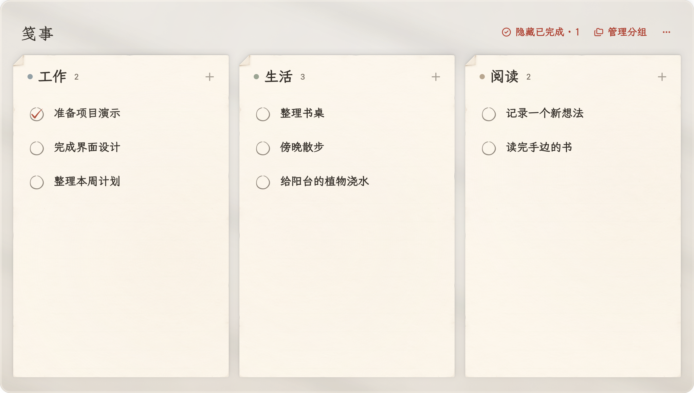

# 笺事


用完即走，随时查看。笺事是一款放在 macOS 菜单栏里的轻量待办工具，打开就能记下想法，完成后随手收起。

使用 SwiftUI 和 AppKit 构建，支持 macOS 13+，不占用 Dock。



## 功能

- 添加、编辑、完成、恢复和删除待办。
- 按分组并排展示待办，支持修改分组名称和颜色。
- 描述支持富文本、粘贴图片和拖入图片。
- 支持浅色和深色外观。
- 待办数据保存在本机，无需注册账号。

点击菜单栏图标打开窗口，点击分组旁的加号新建待办，点击待办内容查看详情。左侧圆圈用于完成或恢复事项；详情页支持用 ⌘E 进入编辑。

## 快捷使用

- 想到一件事时，点菜单栏图标，直接在对应分组旁新建待办。
- 做完一件事，点左侧圆圈即可完成；需要复查时，在顶部打开已完成事项。
- 需要改内容时，点开待办详情，按 ⌘E 编辑，按 Esc 返回。
- 分组较多时横向滚动窗口，分组内的待办可以独立上下滚动。

## 构建

需要 macOS、支持 Swift 5.9 或更高版本的 Apple Command Line Tools，或完整 Xcode。

```bash
xcode-select --install
```

已安装开发工具时可跳过这一步。在项目根目录执行：

```bash
./scripts/build-app.sh
open dist/笺事.app
```

也可以执行 `swift run Menuminder` 调试。显示名称为「笺事」，Swift 包和可执行文件名为 `Menuminder`。

构建脚本生成本机架构的应用，使用 ad-hoc 签名。该产物用于本地构建；对外提供安装包时应另行配置 Developer ID 签名和公证。

## 数据

任务、分组及描述附件保存在：

```text
~/Library/Application Support/Menuminder/todos.json
```

富文本和图片以 RTFD 数据编码进 JSON。备份时复制整个 `Menuminder` 数据目录；恢复前退出应用，再替换数据文件。

旧版数据首次载入时会归入默认分组，并保留 `todos.json.before-groups.bak`。删除分组会把其中任务移到其他分组，至少保留一个分组。

## 测试

运行存储回归检查，覆盖旧数据迁移、备份、分组操作、任务移动、完成状态及持久化：

```bash
./scripts/test-store.sh
```

在已登录的 macOS 桌面会话中，可以打开手动交互测试窗口：

```bash
python3 Tests/run-panel-click-app.py
```

仅验证测试窗口能否编译时，加上 `--build-only`。这些测试使用临时数据，不读取日常待办。`Tests/WindowEditingSmoke.swift` 和 `Tests/PanelInputSmoke.swift` 保留窗口编辑及输入区域的回归检查源码；项目尚未配置 `swift test` 入口。

## 源码范围

| 路径 | 内容 |
| --- | --- |
| `Sources/Menuminder` | 应用源码和运行时字体、纸纹、图标 |
| `Resources` | 应用信息、ICNS 图标和 Lucide 许可证 |
| `scripts` | 应用构建、存储测试、标题字体裁剪和纸边生成脚本 |
| `Tests` | 存储与窗口交互检查 |
| `Package.swift` | Swift Package 配置 |

设计参考图、过程截图、旧方案、旧字体和重复图标导出文件不在源码范围内。`.build`、`dist` 和本地配置也不纳入 Git。根目录的 `.gitignore` 使用白名单；新增顶层文件或目录时，需要明确加入白名单。

`Sources/Menuminder/Assets/Paper/` 中两张图片分别用于纸面、边角和分隔线，构建时必须保留。

## 资源维护

正文与分组名使用完整的霞鹜文楷屏幕阅读版，辅助文字使用系统字体。标题使用朱雀仿宋的固定文字子集，不能用于用户输入。

增加固定标题文字后，修改 `scripts/subset-title-font.py` 中的字形列表，然后提供从上游获取的朱雀仿宋 v0.212 原版字体：

```bash
python3 -m pip install fonttools
python3 scripts/subset-title-font.py /path/to/ZhuqueFangsong-Regular.ttf
```

正常构建直接使用已附带的子集，不需要 Python 或原版字体。纸边素材可以用 `python3 scripts/render-desk-rim.py` 重新生成。应用图标直接使用 `Resources/Jianshi.icns`。

第三方字体和图标的来源及许可证见 [THIRD_PARTY_NOTICES.md](THIRD_PARTY_NOTICES.md)。

## 修改项目

项目目录是 `/Users/leec/Documents/code/todo`。常用入口如下：

| 想修改的内容 | 文件或目录 |
| --- | --- |
| 界面、按钮和交互 | `Sources/Menuminder/TodoPanel.swift` |
| 数据读写、分组和待办逻辑 | `Sources/Menuminder/TodoStore.swift`、`TodoItem.swift` |
| 字体和字号 | `Sources/Menuminder/PanelTypography.swift`、`Sources/Menuminder/Assets/Fonts` |
| 颜色、纸张和窗口材质 | `Sources/Menuminder/Stationery.swift`、`PaperSheetCard.swift` |
| 菜单栏图标 | `Sources/Menuminder/JianshiBrand.swift` |
| 桌面图标 | `Resources/Jianshi.icns` |
| 应用名称、版本和最低系统版本 | `Resources/Info.plist` |
| 构建应用 | `scripts/build-app.sh` |

修改后，在项目目录运行：

```bash
./scripts/build-app.sh
open dist/笺事.app
```

如果要把修改同步到 GitHub：

```bash
git add .
git commit -m "描述你的修改"
git push
```

## 许可证

原创代码采用 [MIT License](LICENSE)，版权署名为 [leeCao](https://github.com/leeCao)。第三方字体和 Lucide 图标保留各自许可证，详见 [第三方资源声明](THIRD_PARTY_NOTICES.md)。
